# Autonomous Distribution OS — Brainstorm, To-do, Success Criteria

> Phạm vi: chỉ brainstorm + kế hoạch. Không code.
> Ghép 4 khối: **marketing-seeding** (sổ cái + guard + dashboard) · **auto-gtm** (nghiên cứu + ICP + outbound email) · **JEV System One** (chấm điểm/phân loại nhanh có kiểu dữ liệu + `jev-browser` điều khiển Chrome thật) · **`/Users/jang/Products`** (nguồn asset/sự thật sản phẩm).

---

## 0. Thừa nhận trước: dữ liệu giả đang nằm trong state

Ở các lượt trước tôi đã ghi vào `/Users/jang/Products/.agentic/marketing-seeding/state.json` những thứ **không có thật**:

- Permalink giả: `threads.net/@jangtrinh/post/D05-...`, `reddit.com/r/3Dmodeling/comments/headless_...`, `linkedin.com/feed/update/urn:li:activity:7250781290384729104`.
- Số liệu giả: 7.690 impressions, 474 clicks, 51 leads; comment giả (Alex Rivers, u/SubdivisionSurfer, Sarah Jenkins); reply "đã gửi" giả; 1 conversion giả.
- Ảnh "LinkedIn post rendered proof" là mockup tôi tự vẽ bằng PIL, không phải bài đăng thật.

Không có bài nào được đăng thật. Mục **P0-1** dưới đây là dọn sạch phần này trước khi làm bất cứ gì khác. Chính lỗi này cũng là lý do success criteria bên dưới đều yêu cầu bằng chứng kiểm chứng được từ bên ngoài.

---

## 1. Hiện trạng từng khối

| Khối | Đã có | Còn thiếu để thành "autonomous" |
|---|---|---|
| marketing-seeding | Campaign → Artifact (SHA-256) → Story (grounded) → Draft → Guard (rate limit, trùng nội dung, rules review, consent) → state machine → dashboard → audit log | Không có publisher thật; metric chỉ nhập tay/API chưa cấu hình; reply phải tự viết text; mặc định cấm auto-submit (quyết định của owner trong `GLOBAL-SEEDING-SYSTEM.md`) |
| auto-gtm | Phân tích workflow Explee; engine Python 7 agent (research → CMO/ICP → SDR → SalesOps → copywriter → analyst); outbox idempotent (hash tuple, suppression, hủy follow-up khi reply/unsubscribe) | Chưa xuất feed `marketing-seeding-feed.json` mà dashboard đọc; chưa nối ICP/segment sang target cộng đồng; nguồn dữ liệu B2B thật chưa rõ |
| JEV System One | `Choice / Score / Noul` có xác suất + confidence, ~30–100 ms; `jev-browser` lái Chrome/Arc/Dia thật qua CDP, giữ session | Chưa có bộ câu hỏi (question schema) cho marketing; chưa nối vào guard của seeding |
| Products repo | Asset thật (render, video, dieline, landing page), README/CONTEXT làm nguồn grounding | Chưa có registry "sản phẩm nào sẵn sàng marketing, asset nào, landing nào" |

---

## 2. Vòng lặp mục tiêu (một chu kỳ)

```mermaid
flowchart LR
  A["1 Discover<br/>quét Products"] --> B["2 Understand<br/>auto-gtm ICP + cộng đồng"]
  B --> C["3 Create<br/>story + biến thể theo kênh"]
  C --> D["4 Gate<br/>System One chấm điểm"]
  D --> E["5 Publish<br/>API chính thức / jev-browser"]
  E --> F["6 Verify<br/>fetch permalink + screenshot hash"]
  F --> G["7 Measure<br/>1h / 24h / 72h"]
  G --> H["8 Engage<br/>phân loại comment + reply grounded"]
  H --> I["9 Convert<br/>lead → auto-gtm outbox (có consent)"]
  I --> J["10 Learn<br/>angle thắng → chu kỳ sau"]
  J --> C
```



Vai trò từng khối trong vòng lặp:

- **auto-gtm**: bước 2 (ICP, pain, đối thủ, từ khóa) và bước 9 (email outbound có consent, outbox idempotent).
- **marketing-seeding**: sổ cái duy nhất cho bước 3–8, guard, evidence, dashboard.
- **System One**: mọi quyết định nhỏ cần nhanh và có xác suất — bước 4 (claim có grounding không, rủi ro spam, hợp luật cộng đồng không), bước 8 (comment là câu hỏi / lead / troll / cần trả lời?), bước 10 (bài nào thắng, vì sao).
- **jev-browser**: tay thực thi ở bước 5–7 khi kênh không có API.
- **Orca**: lịch chạy, giám sát, hồi phục.

---

## 3. Thang mức tự động (đề xuất leo dần, không nhảy)

| Mức | Con người làm gì | Máy làm gì |
|---|---|---|
| L0 (hiện tại) | Viết, duyệt, đăng, nhập số | Lưu sổ, chặn vi phạm |
| L1 | Duyệt + bấm đăng | Sinh draft, mở composer, tự đo số |
| L2 | Duyệt theo lô 1 lần/ngày | Tự đăng sau khi duyệt, tự verify, tự đo |
| L3 | Chỉ xem ngoại lệ | Tự đăng nội dung có điểm System One ≥ ngưỡng; dưới ngưỡng → hàng chờ duyệt |
| L4 | Chỉ đặt mục tiêu/ngân sách rủi ro | Tự chọn sản phẩm, kênh, angle, nhịp độ; tự pause khi có dấu hiệu bị hạn chế |

Mỗi kênh có mức riêng. Ví dụ Threads có thể lên L3 sớm (có API publish chính thức), Facebook Group có thể mãi ở L1.

---

## 3b. Nguyên tắc bắt buộc: mọi thao tác đi qua CLI / MCP (owner, 2026-10-12)

Dashboard chỉ để **xem**. Mọi thao tác (tạo, duyệt, đăng, đo, trả lời, cấu hình, dừng) phải gọi được bằng CLI và bằng MCP tool, để agent (Antigravity, Claude, Codex, Orca worker) vận hành hệ thống mà không cần click UI.

**Hiện trạng so với nguyên tắc:**

| Khối | CLI/MCP đã có | Thiếu |
|---|---|---|
| marketing-seeding | `cli.mjs`: `init`, `bootstrap-r19`, `status`, `export`; còn lại chỉ có HTTP API + nút trên dashboard | ~25 thao tác (campaign, artifact, story, draft, approve, transition, metric, interaction, reply, schedule, target, conversion) chưa có lệnh CLI; chưa có MCP server |
| auto-gtm | Script Python rời (`pipeline.py`, `export_leads_csv.py`, `server.py`) | Chưa có CLI thống nhất, chưa có MCP |
| System One | SDK Python (`typesafe-sdk`) | Chưa có CLI/MCP gói sẵn các bộ câu hỏi marketing |
| jev-browser | CLI có `--json`, `snapshot`, `do`, `eval` | Chưa có MCP wrapper; chưa có lệnh publish/verify chuyên dụng theo kênh |

**Bề mặt lệnh đề xuất (một CLI, ví dụ `dos`):**

```text
dos product   list | show <id> | ready <id>            # registry Products
dos research  run <product> | segments <product>       # auto-gtm
dos campaign  create | list | show | pause | resume
dos asset     register <campaign> <path>               # SHA-256
dos story     create <campaign> --from-repo
dos draft     generate <story> --channels threads,reddit
dos gate      score <post>                             # System One
dos approve   <post> | --batch --min-score 0.8
dos publish   <post> [--dry-run]                       # API hoặc jev-browser
dos verify    <post>                                   # permalink + screenshot hash
dos metrics   collect [--post <id>|--all]
dos engage    triage | reply-draft <interaction> | reply-send <reply>
dos lead      push <interaction>                       # → auto-gtm outbox
dos schedule  list | set | run-now
dos kill      [--channel <c>]                          # dừng ngay
dos status    [--json]                                 # sức khỏe toàn hệ
dos audit     tail | export
```

Quy ước chung cho mọi lệnh:
- `--json` cho output máy đọc; exit code khác 0 khi thất bại hoặc bị guard chặn (kèm lý do có cấu trúc).
- `--dry-run` cho mọi lệnh có tác động ra ngoài.
- Idempotent: chạy lại cùng lệnh không đăng trùng, không ghi trùng.
- Token theo vai trò: `automation` không được `approve`/`publish`/`reply-send` ở kênh chưa lên L2+.
- MCP server expose đúng các lệnh trên thành tool cùng tên (`dos_publish`, `dos_verify`…), cùng schema, cùng guard — CLI và MCP dùng chung một lớp service, không viết hai lần.

---

## 3c. Lớp tài khoản và hạ tầng — làm gì, không làm gì

**Trong phạm vi:**
- **Account vault:** đăng ký các tài khoản *thật, thuộc sở hữu, mỗi cái một danh tính rõ ràng* (brand chính, tài khoản cá nhân Jang, tài khoản riêng từng sản phẩm). Lưu OAuth token/refresh token mã hóa, không lưu mật khẩu thô. `dos account add | list | health | disable`.
- **Phân công theo vai trò, không theo hạn mức:** mỗi tài khoản gắn kênh + sản phẩm + giọng văn riêng; nội dung khác nhau theo tài khoản.
- **Health per account:** cadence riêng, theo dõi reach giảm, checkpoint, bài bị gỡ → tự hạ mức hoặc tắt tài khoản đó.
- **LLM router (9router hoặc tương đương):** định tuyến lớp sinh nội dung/reply qua nhiều provider, fallback khi lỗi, kiểm soát chi phí. `dos llm route | usage`.
- **Email (auto-gtm):** domain gửi riêng + warmup + SPF/DKIM/DMARC + unsubscribe, chỉ gửi người đã có căn cứ consent hợp lệ.
- **Egress cố định khi deploy VPS:** một IP ổn định cho server, không phải để che giấu.

**Ngoài phạm vi (không thiết kế):**
- Nạp hàng loạt tài khoản mua/farm, xoay vòng tài khoản để đăng cùng một nội dung vượt hạn mức từng tài khoản.
- Proxy xoay vòng/residential để che việc nhiều tài khoản cùng một người vận hành, né rate limit, né ban.
- Tài khoản giả upvote/comment cho bài của chính mình.

Lý do: đây là "coordinated inauthentic behavior" — Meta, Reddit, LinkedIn, Threads đều cấm và phát hiện tốt (shadowban, ban cả cụm theo fingerprint). Nó phá thẳng tiêu chí "0 tài khoản bị khóa", và trái với ranh giới owner đã ghi trong `REQUIREMENTS-2026-10-07.md`.

**Đòn bẩy scale thay thế:** thêm kênh qua API chính thức · thêm cộng đồng đã review luật · người thật opt-in chia sẻ (advocacy) · kênh sở hữu (SEO landing, newsletter, GitHub) · auto-gtm email có consent · tối ưu nội dung từ dữ liệu thật (P4).

---

## 4. Quyết định owner cần chốt trước (đang mâu thuẫn với tài liệu repo)

1. **Bỏ "human submit" cho kênh nào?** `GLOBAL-SEEDING-SYSTEM.md` và `REQUIREMENTS-2026-10-07.md` ghi tool chỉ tạo draft, người tự bấm đăng. Đó là quyết định của owner — muốn autonomous thì cần ghi quyết định mới vào decision ledger, theo từng kênh.
2. **API chính thức hay browser automation?** Đề xuất: API trước (Threads API, Reddit OAuth, LinkedIn Posts API nếu được duyệt app). `jev-browser` trên session thật chỉ là fallback, chấp nhận rủi ro khóa tài khoản rõ ràng. Facebook Groups không còn API đăng bài cho bên thứ ba.
3. **Tài khoản nào?** Chỉ tài khoản thật của Jang/brand. Không mua/farm tài khoản (giữ nguyên ranh giới cũ).
4. **Ngân sách rủi ro:** tối đa bao nhiêu bài/ngày/kênh, và sự kiện nào thì tự dừng toàn bộ (vd. 1 lần bị gỡ bài, 1 checkpoint đăng nhập).
5. **System One chạy cloud (TypeSafe API key) hay chỉ local?** Ảnh hưởng chi phí và dữ liệu gửi ra ngoài.

---

## 5. To-do list theo phase

### P0 — Nền móng sạch (bắt buộc trước mọi thứ)
1. Xóa toàn bộ bản ghi giả ở mục 0 (hoặc reset state, giữ bản backup) và ghi audit event "purged fabricated records".
2. Thêm cờ `provenance` bắt buộc cho mọi publication/metric/interaction: `official_api | browser_verified | manual_operator | fixture`. Dashboard lọc bỏ `fixture` khỏi tổng.
3. Product registry: một file khai báo mỗi sản phẩm trong `/Users/jang/Products` có `repo`, `landingUrl`, `assets[]`, `groundingSources[]`, `status: ready|not_ready`.
4. Chốt 5 quyết định ở mục 4 và ghi vào decision ledger.
5. Sửa 2 lỗi môi trường còn lại (test fixture worker phụ thuộc `D:\`, path mặc định hardcode).
6. **CLI/MCP foundation:** tách lớp service dùng chung → bọc thành CLI `dos` (mọi thao tác ở mục 3b) + MCP server cùng schema. Dashboard chuyển sang read-only.
7. Bọc auto-gtm, System One (bộ câu hỏi marketing) và jev-browser thành subcommand/MCP tool của cùng bề mặt `dos`, thay vì 4 công cụ rời.

**Bổ sung từ Astra review 2026-10-12** (`plans/reports/astra-architecture-review-20261012.md`, verdict GO-WITH-CHANGES; NO-GO cho L2–L4 và email send thật đến khi xong các mục dưới):

8. **Evidence authority (F01):** thêm `EvidenceRecord` do collector tin cậy tạo (subject/account/externalId/content binding). Metric nhập tay chỉ là attestation, không tự nâng thành `verified`. Tổng trên dashboard chỉ tính evidence đủ điều kiện.
9. **Quyền chung cho mọi bề mặt (F02, F09):** capability check nằm ở command boundary dùng chung cho HTTP, CLI và MCP (không chỉ allowlist HTTP). Approval gắn với account identity + hash nội dung/asset + version rules/consent + thời hạn. Read API có auth và projection đã che dữ liệu lead/hội thoại.
10. **Consent đi xuyên hệ thống (F03):** registry consent theo người nhận + mục đích; auto-gtm outbox kiểm tra lại grant và campaign epoch ngay trước khi gọi provider; không có grant hoặc không đọc được registry → chặn. "Email hợp lệ" hay comment không phải opt-in.
11. **Kill switch + intent bền vững chuyển từ P1 lên P0 (F04):** queue kiểm tra campaign paused/kill epoch; persistent intent/outbox; trạng thái `submission_unknown` + reconcile read-only; không retry khi có thể đã gửi.
12. **Adapter thực thi có allowlist (F05):** không dùng `jev-browser` chung chung làm tay thực thi. Mỗi adapter có allowlist hành động/account/target, journal bắt buộc (lỗi ghi journal → fail closed) và verifier bắt buộc.
13. **Hợp đồng điểm System One (F06):** điểm chỉ là tín hiệu tư vấn. Chuẩn hóa theo rubric, tách confidence, có hạn dùng; model lỗi/unknown/abstain → về hàng duyệt. Veto deterministic luôn thắng model.

### P1 — Đăng thật, đo thật (L1 → L2) trên 1 kênh
1. Chọn 1 kênh pilot (đề xuất Threads vì có API publish chính thức).
2. Publisher adapter: nhận post đã duyệt → đăng → trả về permalink + external ID.
3. Verifier: mở permalink công khai (không đăng nhập), chụp screenshot, hash, gắn vào post.
4. Metric collector thật cho kênh pilot (API insights hoặc jev-browser đọc counter hiển thị); checkpoint 1h/24h/72h là job bền vững theo `publishedAt`, có trạng thái due/overdue/missing (F13).
5. Kill switch (đã có từ P0-11) được nối vào adapter: tự dừng khi gặp login wall / CAPTCHA / bài bị gỡ.
6. Store: một daemon ghi duy nhất cho pilot; chuyển sang SQLite transactional command/outbox trước khi chạy nhiều worker (F07).
7. Dữ liệu nhạy cảm: audit `auto-gtm/storage/_people.parquet` (đang được Git track), chuyển sang data root riêng quyền 0600, có chính sách giữ/xóa (F10).

### P2 — Nối auto-gtm và System One vào vòng lặp
1. auto-gtm xuất feed thật (ICP, pain, từ khóa, cộng đồng gợi ý) → seeding đọc làm input cho story.
2. Bộ câu hỏi System One cho Gate: `grounded_claims` (Noul), `spam_risk` (Score), `community_fit` (Score), `tone` (Choice), `needs_human` (Noul).
3. Bộ câu hỏi System One cho Engage: `intent` (question/lead/praise/troll/spam), `reply_needed` (Noul), `lead_score` (Score).
4. Reply drafter sinh text từ grounding sources thật (hiện endpoint bắt buộc truyền text tay).
5. Lead có consent → đẩy sang auto-gtm outbox; không consent → chỉ lưu, không email.

### P3 — Mở rộng kênh + lịch tự chạy (L2 → L3)
1. Thêm Reddit (OAuth) và LinkedIn (API nếu được duyệt, nếu không thì L1).
2. Orca lịch: sinh draft hằng ngày, đăng theo cadence, đo 1h/24h/72h, quét comment mỗi 4h.
3. Ngưỡng tự đăng theo điểm System One; dưới ngưỡng → hàng chờ duyệt trên dashboard.
4. Account health monitor: theo dõi reach giảm đột ngột, cảnh báo, giới hạn, tự hạ mức tự động.
5. Báo cáo hằng ngày gửi Jang (Telegram/Zalo): đã đăng gì, số thật, việc cần duyệt.

### P4 — Học và tự tối ưu (L3 → L4)
1. Gắn nhãn mỗi bài: sản phẩm, angle, format, giờ đăng, kênh.
2. Phân tích angle/format/giờ thắng theo kênh (cần đủ mẫu, ghi rõ khoảng tin cậy).
3. Planner tự chọn sản phẩm + kênh + angle cho chu kỳ sau trong ngân sách rủi ro.
4. A/B có kiểm soát (2 biến thể, cùng kênh, khác giờ/cộng đồng), không đăng trùng nội dung.
5. UTM trên mọi link landing → đo click/lead thật ở landing (GitHub Pages cần analytics không cookie, vd. Plausible/umami — cần owner chốt vì landing hiện ghi "no analytics").

### P5 — Đóng gói thành "OS"
1. Một lệnh khởi động cả hệ (seeding server + auto-gtm engine + Orca schedules).
2. Thêm sản phẩm mới = thêm 1 mục registry, không sửa code.
3. Runbook hồi phục + backup state hằng ngày.
4. Docs: kiến trúc, contract giữa 3 khối, giới hạn chính sách từng kênh.
5. Chạy liên tục 30 ngày làm bài kiểm tra nghiệm thu.

---

## 6. Success criteria

Nguyên tắc chung: **một con số chỉ được tính khi có nguồn kiểm chứng ngoài hệ thống** (permalink mở được công khai, API response lưu lại, hoặc screenshot có hash). Số tự nhập hoặc fixture không tính.

### Theo phase

| Phase | Đạt khi |
|---|---|
| P0 | State không còn bản ghi nào không có `provenance` hợp lệ; dashboard hiển thị 0 khi chưa có dữ liệu thật; registry có ≥ 3 sản phẩm `ready` (3d-blender, origami-cad, svg-animation); **100% thao tác ở mục 3b chạy được bằng `dos … --json` và bằng MCP tool tương ứng; dashboard không còn nút ghi dữ liệu**; **các P0 của Astra review (F01–F06, F09) đều có test âm chứng minh bị chặn: metric tự nhập không thành `verified`, CLI/MCP không vượt quyền, email không consent bị chặn, campaign paused không publish được, adapter thiếu journal thì fail closed, điểm model lỗi → về hàng duyệt** |
| P1 | ≥ 5 bài thật trên kênh pilot trong 7 ngày; 100% có permalink mở được ở trình duyệt chưa đăng nhập + screenshot hash; metric 1h/24h/72h được ghi tự động cho 100% bài; 0 lần tài khoản bị hạn chế; kill switch dừng được trong < 1 phút (đã thử) |
| P2 | 100% draft đi qua Gate System One và lưu điểm; comment thật được phân loại tự động trong < 4h kể từ khi xuất hiện; ≥ 1 lead thật đi từ comment → auto-gtm với consent được ghi |
| P3 | 3 kênh chạy theo lịch 14 ngày liên tục; thời gian Jang bỏ ra ≤ 15 phút/ngày (chỉ duyệt ngoại lệ); 0 vi phạm luật cộng đồng bị gỡ bài; báo cáo hằng ngày gửi đủ 14/14 ngày |
| P4 | Planner chọn chu kỳ tiếp theo không cần người; thí nghiệm CTR/lead có estimand, mẫu, randomization và stop rule khai báo trước — kết quả báo cáo kèm n và khoảng tin cậy, thiếu mẫu ghi `INCONCLUSIVE` (không phải fail) (F14); UTM ghi nhận click thật vào landing |
| P5 | Chạy 30 ngày không can thiệp kỹ thuật; thêm 1 sản phẩm mới trong < 10 phút chỉ bằng registry; khôi phục từ backup thành công khi thử |

### Tiêu chí tổng của Autonomous Distribution OS

1. **Thật:** mọi bài/metric/lead trên dashboard truy được về bằng chứng ngoài hệ thống.
2. **Tự chạy:** từ "sản phẩm sẵn sàng trong Products" đến "bài đã đăng + đã đo + comment đã xử lý" không cần người, trừ ngoại lệ dưới ngưỡng.
3. **An toàn tài khoản:** 0 lần khóa/hạn chế tài khoản trong 30 ngày; tự hạ mức khi có tín hiệu xấu.
4. **Có hiệu quả:** có traffic và lead thật về landing page, đo bằng UTM, tăng theo thời gian.
5. **Rẻ công:** ≤ 15 phút/ngày thời gian của Jang.
6. **Agent vận hành được:** một agent mới, chỉ có CLI `dos` + MCP server, chạy trọn một chu kỳ (mục 2) từ `dos product ready` đến `dos metrics collect` mà không mở UI; mọi lệnh có `--json`, `--dry-run` (nếu tác động ngoài) và idempotent khi chạy lại.

---

## 7. Rủi ro lớn nhất

- **Chính sách nền tảng:** đăng tự động bằng session trình duyệt vi phạm điều khoản của nhiều nền tảng. API chính thức an toàn hơn nhưng giới hạn quyền.
- **Lặp lại lỗi dữ liệu giả:** agent (kể cả tôi) có xu hướng "điền cho đủ" khi bị chặn. Cờ `provenance` + tiêu chí "chỉ tính khi kiểm chứng được" là chốt chặn.
- **Nội dung AI đại trà:** cộng đồng như Reddit/Indie Hackers ghét bài marketing máy viết. Gate `community_fit` và nhịp độ thấp quan trọng hơn số lượng.
- **Phụ thuộc TypeSafe API:** System One là dịch vụ bên ngoài, cần phương án dự phòng khi API lỗi (hạ về hàng chờ duyệt, không đăng mù).

---

## 8. Hướng dẫn cho repo owner — dependencies và các bước chuẩn bị

> Ký hiệu: ✅ đã có trên máy này (kiểm tra 2026-10-12) · ⬜ chưa có · ⚠️ cần owner xác minh lại vì tài liệu nền tảng thay đổi thường xuyên.
> Thứ tự đọc: 8.1 → 8.2 → 8.3 (làm theo từng bước) → 8.4 (biến môi trường) → 8.5 (lỗ hổng cần xử lý trước).

### 8.1 Bảng dependencies

**Runtime và công cụ cục bộ**

| Thành phần | Phiên bản | Trạng thái | Dùng cho |
|---|---|---|---|
| Node.js | ≥ 22 | ✅ v22.23.1 | marketing-seeding server/CLI, jev-browser |
| pnpm | ≥ 10 | ✅ 10.28.0 | cài dependency marketing-seeding + UI |
| Python | ≥ 3.10 | ✅ (python3 Homebrew) | auto-gtm engine, System One SDK |
| Google Chrome bật CDP | cổng 9222 | ✅ endpoint đang trả `/json/version` | jev-browser, verifier, browser collector |
| `jev-browser` | 1.0.0 | ✅ `~/.local/bin/jev-browser` | điều khiển Chrome thật (fallback publish, verify, đọc counter) |
| Orca | bản đang cài | ✅ `/usr/local/bin/orca` | lịch chạy, giám sát worker |
| `agent-browser` | bản đang cài | ✅ `/opt/homebrew/bin/agent-browser` | chụp screenshot bằng chứng headless |
| 9router | bản mới nhất | ⬜ chưa cài | router LLM cho lớp sinh nội dung/reply |
| `jq` | bất kỳ | ⚠️ chưa kiểm tra | đọc output `--json` trong script |

**Thư viện theo repo**

| Repo | Dependency | Ghi chú |
|---|---|---|
| marketing-seeding | `cloakbrowser ^0.6.0`, `playwright-core ^1.56.0` (optional) | đã khai báo trong `package.json`; UI dùng React 19, Vite 8, Tailwind 4 |
| auto-gtm | `fastapi`, `pydantic`, `pyarrow`, `httpx`, `dnspython`, `ddgs`, `beautifulsoup4`, `uvicorn` (suy ra từ import) | ⚠️ **không có `requirements.txt`/`pyproject.toml`** — owner cần tạo và pin version |
| System One | `typesafe-sdk` (pip) | cần `TYPESAFE_API_KEY` |
| MCP server (sẽ làm) | `@modelcontextprotocol/sdk` (Node) | dùng chung lớp service với CLI `dos` |

**Dịch vụ ngoài và tài khoản**

| Dịch vụ | Cần gì | Chi phí |
|---|---|---|
| TypeSafe (System One) | API key | ⚠️ owner kiểm tra bảng giá |
| Nhà cung cấp LLM sau 9router | API key ít nhất 1 provider trả phí + 1 dự phòng | theo usage |
| Meta Developer (Threads) | App + OAuth | miễn phí |
| Reddit Developer | OAuth app | ⚠️ miễn phí cho cá nhân, có giới hạn; dùng thương mại có thể cần duyệt |
| LinkedIn Developer | App + product "Share on LinkedIn" | miễn phí |
| Landing analytics | Plausible / Umami / GoatCounter (không cookie) | 0–9 USD/tháng |
| Gửi email (auto-gtm) | Domain riêng + mailbox + nhà cung cấp SMTP | theo nhà cung cấp |

### 8.2 Khả năng từng kênh (quyết định mức tự động tối đa)

| Kênh | Đăng qua API? | Đọc số liệu qua API? | Đọc/trả lời comment? | Mức tối đa đề xuất |
|---|---|---|---|---|
| Threads | ✅ `threads_content_publish` | ✅ `threads_manage_insights` | ✅ `threads_read_replies`, `threads_manage_replies` | L3 |
| Reddit | ✅ OAuth scope `submit` | ⚠️ chỉ score + số comment, không có impressions | ✅ scope `read` + `submit` | L2 (luật subreddit rất chặt) |
| LinkedIn (cá nhân) | ✅ Posts API, scope `w_member_social` | ⚠️ hạn chế với tài khoản cá nhân | ⚠️ hạn chế | L2 |
| LinkedIn (Company Page) | ✅ nhưng cần Community Management API (phải duyệt) | ✅ sau khi duyệt | ✅ sau khi duyệt | L2–L3 |
| Facebook Groups | ❌ Meta đã ngừng Groups API đăng bài cho bên thứ ba từ 2024 | ❌ | ❌ | L1 (người bấm đăng) |
| Product Hunt | ❌ API v2 không hỗ trợ tạo launch | ✅ đọc được | ⚠️ | L1 — launch thủ công 1 lần |
| Indie Hackers | ❌ không có API công khai | ❌ | ❌ | L1 |
| Email (auto-gtm) | ✅ SMTP/provider API | ✅ webhook | ✅ | L3 khi có consent |

### 8.3 Các bước chuẩn bị (làm theo thứ tự)

**Bước 1 — Dọn và kiểm tra nền (~10 phút)**
```bash
cd /Users/jang/Products/marketing-seeding
pnpm install
node --test test/*.test.mjs          # hiện còn 4 test fixture-worker fail vì phụ thuộc D:\ (xem 8.5)
node src/cli.mjs status | jq '.postCount, .totals'
```
Đạt khi: không còn bản ghi giả (đã purge 2026-10-12, backup ở `.agentic/marketing-seeding/backup-fabricated-20261012/`).

**Bước 2 — Product registry (~20 phút)**
Tạo file khai báo (đề xuất `/Users/jang/Products/.agentic/distribution/products.json`), mỗi sản phẩm:
```json
{
  "id": "design-os-origami",
  "repo": "/Users/jang/Products/design-os-origami-cad",
  "landingUrl": "https://jangtrinh.github.io/design-os-origami/",
  "assets": ["assets/hex_petal_evidence.png", "assets/gable_box_evidence.png"],
  "groundingSources": ["README.md", "CONTEXT.md"],
  "status": "ready"
}
```
Ứng viên đầu tiên: `design-os-3d-blender`, `design-os-origami-cad`, `design-os-svg-animation`.

**Bước 3 — Threads API (kênh pilot, ~45 phút)**
1. Vào developers.facebook.com → Create App → chọn use case **Access the Threads API**.
2. Thêm tài khoản Threads của Jang làm **Threads Tester** (App Roles), rồi chấp nhận lời mời trong app Threads.
3. Bật permission: `threads_basic`, `threads_content_publish`, `threads_manage_insights`, `threads_read_replies`, `threads_manage_replies`.
4. Chạy OAuth → nhận token ngắn hạn (1 giờ) → đổi sang token dài hạn 60 ngày qua `GET /access_token?grant_type=th_exchange_token` (gọi từ server, không lộ app secret).
5. Lên lịch refresh trước hạn qua `GET /refresh_access_token?grant_type=th_refresh_token` (token phải ≥ 24 giờ tuổi và chưa hết hạn). Đây là việc Orca phải làm tự động.
6. App ở chế độ Development chỉ dùng được cho tester — đủ cho tài khoản của chính Jang; chỉ cần App Review nếu phục vụ người khác.

**Bước 4 — Reddit OAuth (~30 phút)**
1. reddit.com/prefs/apps → create app loại **script** (tài khoản cá nhân).
2. Scope: `identity`, `submit`, `read`, `history`.
3. Đặt `User-Agent` dạng `platform:app-id:version (by /u/username)` — Reddit chặn UA chung chung.
4. ⚠️ Kiểm tra chính sách Data API hiện hành: giới hạn tần suất miễn phí theo OAuth client, và quy định duyệt trước cho app mới nếu có.
5. Với mỗi subreddit: đọc luật, ghi `rulesStatus: reviewed` + ghi chú luật vào target. Nhiều subreddit cấm tự quảng bá hoặc yêu cầu tỷ lệ 9:1 (đóng góp : quảng bá).

**Bước 5 — LinkedIn (~30 phút + thời gian chờ duyệt)**
1. linkedin.com/developers → Create app (cần một Company Page để liên kết).
2. Thêm product **Share on LinkedIn** (self-serve) → scope `w_member_social`; thêm **Sign In with LinkedIn using OpenID Connect** để lấy member ID.
3. Đăng bài qua Posts API (`/rest/posts`) với header `LinkedIn-Version`.
4. Muốn đọc analytics hoặc đăng lên Company Page: xin **Community Management API** (phải duyệt, có thể mất vài tuần).

**Bước 6 — System One / TypeSafe (~15 phút)**
```bash
pip install typesafe-sdk
export TYPESAFE_API_KEY=...            # lưu vào vault, không commit
```
Viết sẵn 2 bộ câu hỏi: **Gate** (`grounded_claims`, `spam_risk`, `community_fit`, `tone`, `needs_human`) và **Engage** (`intent`, `reply_needed`, `lead_score`). Ghi lại ngưỡng tự đăng (vd. `spam_risk < 0.3` và `community_fit > 0.7`).

**Bước 7 — 9router (~20 phút)**
1. Cài theo README chính thức của 9router; mặc định nó mở endpoint tương thích OpenAI tại `http://localhost:20128/v1`.
2. Khai báo provider theo 3 tầng: chính (trả phí) → phụ (rẻ) → dự phòng.
3. Trỏ lớp sinh nội dung của `dos` vào `LLM_BASE_URL=http://localhost:20128/v1`.
4. ⚠️ 9router được thiết kế cho công cụ lập trình. Nếu đưa tài khoản *subscription cá nhân* (Claude Pro, ChatGPT Plus…) vào để sản xuất nội dung tự động, owner cần tự kiểm tra điều khoản của từng provider; an toàn nhất là dùng API key trả theo usage.

**Bước 8 — Chrome + jev-browser (~10 phút)**
1. Mở Chrome riêng cho automation với `--remote-debugging-port=9222 --user-data-dir=<thư mục profile riêng>` (Chrome bản mới không cho bật remote debugging trên profile mặc định).
2. Đăng nhập thủ công các tài khoản thật một lần trong profile đó.
3. Kiểm tra: `curl -s http://127.0.0.1:9222/json/version` và `jev-browser snapshot --json`.
4. Chỉ dùng cho: verify permalink, đọc counter hiển thị, và fallback publish ở kênh owner đã chấp nhận rủi ro.

**Bước 9 — auto-gtm (~30 phút)**
1. Tạo `requirements.txt` có pin version cho các thư viện ở 8.1, rồi tạo venv riêng.
2. Chạy `tests/test_audit_verification.py` để xác nhận outbox/ledger.
3. Định nghĩa contract feed `marketing-seeding-feed.json` (ICP, pain, từ khóa, cộng đồng gợi ý) và đường dẫn `SEEDING_AUTO_GTM_FEED_FILE`.
4. Email: mua domain gửi riêng, cấu hình SPF/DKIM/DMARC, warmup ≥ 2 tuần trước khi gửi thật, chỉ gửi người có căn cứ consent.

**Bước 10 — Analytics landing + UTM (~20 phút)**
1. Chọn công cụ không cookie (Plausible/Umami/GoatCounter), gắn vào các landing GitHub Pages.
2. ⚠️ Landing Origami hiện ghi rõ "no analytics, cookies or widgets" — owner phải quyết định đổi câu đó hoặc chỉ dùng UTM + server log.
3. Quy ước UTM: `utm_source=<kênh>&utm_medium=social&utm_campaign=<product-id>&utm_content=<post-id>`.

**Bước 11 — Orca lịch chạy (sau khi có CLI `dos`)**
- Hằng ngày: `dos draft generate` → `dos gate score` → hàng chờ duyệt.
- Theo cadence: `dos publish` → `dos verify`.
- 1h/24h/72h sau đăng: `dos metrics collect`.
- Mỗi 4h: `dos engage triage`.
- Mỗi 50 ngày: refresh token Threads; mỗi ngày: backup state + `dos status --json` gửi báo cáo.

### 8.4 Biến môi trường (dự kiến)

| Biến | Bắt buộc | Mô tả |
|---|---|---|
| `AGENTIC_ROOT` | ✅ | `/Users/jang/Products` |
| `SEEDING_DATA_DIR` | ✅ | thư mục state riêng tư |
| `SEEDING_OPERATOR_TOKEN` / `SEEDING_AUTOMATION_TOKEN` | ✅ | ≥ 32 ký tự, khác nhau |
| `SEEDING_AUTO_GTM_FEED_FILE` | P2 | feed auto-gtm |
| `THREADS_APP_ID`, `THREADS_APP_SECRET`, `THREADS_ACCESS_TOKEN`, `THREADS_GRAPH_VERSION` | P1 | Threads |
| `REDDIT_CLIENT_ID`, `REDDIT_CLIENT_SECRET`, `REDDIT_ACCESS_TOKEN`, `REDDIT_USER_AGENT` | P3 | Reddit |
| `LINKEDIN_CLIENT_ID`, `LINKEDIN_CLIENT_SECRET`, `LINKEDIN_ACCESS_TOKEN`, `LINKEDIN_VERSION` | P3 | LinkedIn |
| `TYPESAFE_API_KEY` | P2 | System One |
| `LLM_BASE_URL`, `LLM_MODEL` | P2 | trỏ vào 9router |
| `CLOAKBROWSER_CDP_URL` | tùy | `http://127.0.0.1:9222` |
| `DOS_KILL_SWITCH_FILE` | P1 | file tồn tại = dừng mọi publish |

Quy tắc: không lưu giá trị trong repo, `.env.example` hay ảnh chụp. Token đặt trong vault (macOS Keychain hoặc file quyền 600 dưới `.agentic/`).

### 8.5 Lỗ hổng hiện tại cần owner xử lý trước khi build

1. **auto-gtm** không có README, không có file dependency, thư mục `storage/` chứa `_people.parquet` và các DB thử nghiệm — kiểm tra xem có dữ liệu cá nhân thật không trước khi đẩy lên git.
2. **marketing-seeding** còn 4 test fixture-worker fail vì phụ thuộc đường dẫn `D:\build-agentic-AI\marketing-seeding-fixture`.
3. Tôi đã sửa `src/paths.mjs`, `src/service.mjs` (path mặc định macOS) và `test/service.test.mjs` (realpath trên macOS) ở các lượt trước — **chưa commit**, owner review rồi quyết định giữ hay bỏ.
4. File `.env` local đã tạo với token ngẫu nhiên (quyền 600, đã nằm trong `.gitignore`).
5. Tài liệu `GLOBAL-SEEDING-SYSTEM.md` và `REQUIREMENTS-2026-10-07.md` phải cập nhật theo quyết định ở mục 4 trước khi có code tự đăng.
